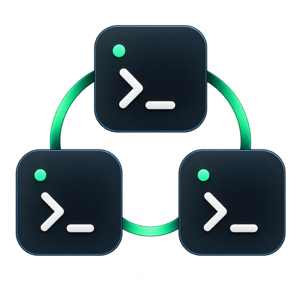
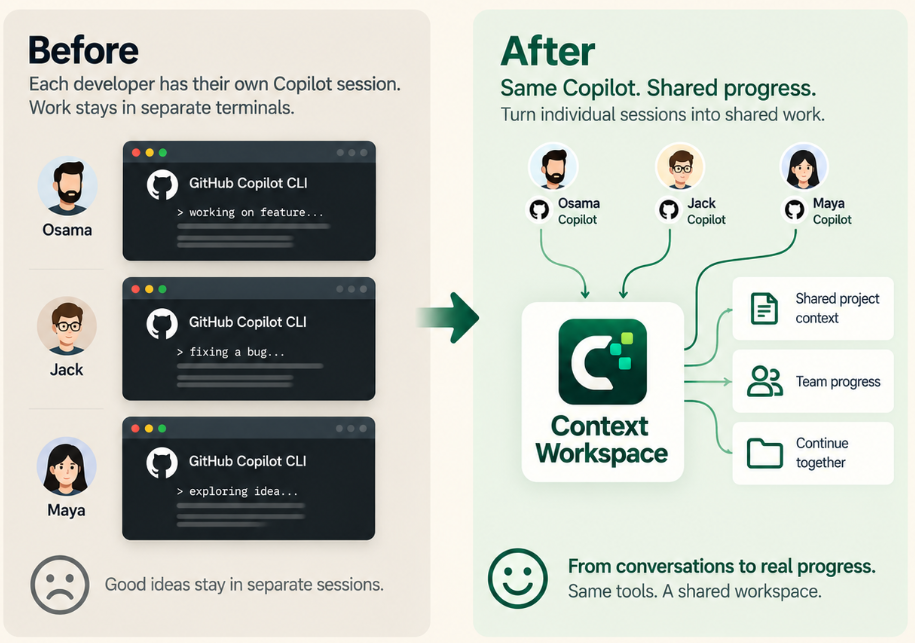

<p align="center">
  
</p>

<h1 align="center">Context Workspace</h1>

<p align="center"><strong>Where AI work becomes shared projects.</strong></p>

<p align="center">
  Public website, documentation, bootstrap installer, and verified release downloads for Context Workspace.
</p>

<p align="center">
  <a href="https://oabouhajar.github.io/smart-ai-human-manager/"><strong>Website</strong></a>
  ·
  <a href="https://oabouhajar.github.io/smart-ai-human-manager/dashboard-demo.html">Interactive demo</a>
  ·
  <a href="https://github.com/OAbouHajar/smart-ai-human-manager/releases/latest">Latest release</a>
</p>

<p align="center">
  
</p>

## Install

Requirements: Git, Node.js 22.13+, a supported AI agent, and PowerShell 7 on Windows.

### Install with one prompt

Copy this prompt into GitHub Copilot, Microsoft Scout, Claude Code, OpenAI Codex, Google Gemini, or another capable AI agent:

```text
Install Context Workspace from https://github.com/OAbouHajar/smart-ai-human-manager on this machine.

Detect the operating system first. Verify git, Node.js 22.13 or newer, at least one supported AI agent, and PowerShell 7 on Windows. Stop and report the missing prerequisite if the platform is unsupported or a requirement is unavailable.

Clone the public distribution repository into a temporary directory, read its README and bootstrap installer, then run the matching installer with its no-open option:
- Windows: `pwsh -File .\scripts\install.ps1 -NoOpen`
- macOS: `./scripts/install.sh --no-open`

The bootstrap installer must download the exact latest stable Context Workspace release, verify its SHA-256 checksum, preserve existing Context Workspace data and unrelated AI-agent settings, configure every detected supported provider, and start the local service.

Verify `http://127.0.0.1:43120/api/health` returns `ok: true`, open the dashboard, and report the installed version, configured providers, and any remaining restart action. Proceed autonomously and only ask before administrator-required or destructive actions.
```

The agent uses the public bootstrap installer. Product source code is not required for installation.

### Install manually

**Windows**

```powershell
git clone https://github.com/OAbouHajar/smart-ai-human-manager.git
Set-Location .\smart-ai-human-manager
pwsh -File .\scripts\install.ps1
```

**macOS**

```bash
git clone https://github.com/OAbouHajar/smart-ai-human-manager.git
cd smart-ai-human-manager
./scripts/install.sh
```

The bootstrap installer downloads the latest stable release package, verifies its SHA-256 checksum, and runs the platform installer. Existing Context Workspace data and unrelated AI-agent settings are preserved.

## Supported agents

GitHub Copilot CLI, Microsoft Scout, Claude Code, OpenAI Codex CLI, and Google Gemini CLI.

## Source and privacy

This public repository contains the website, bootstrap installer, and release distribution metadata. Product source development is maintained in a private repository.

The installed product runs locally on `127.0.0.1` and stores session data on the user's machine.

---

Context Workspace is independent software and is not an official GitHub, Microsoft, Anthropic, OpenAI, or Google product.
